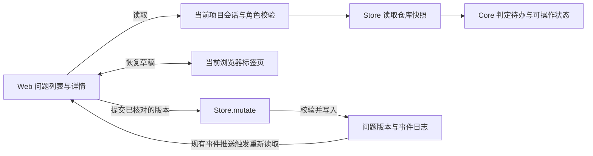

# UX-2 问题处理架构评审与改造方案

2026-11-19 · 基于 `9baf321` · 方案评审稿

建议在现有收件箱入口增加「问题」和「其他审批」两个页签。产品人员在问题页签里发现事项，进入单题详情核对答案，确认、退回或提交新版本，再从结果区域继续下一项。服务端根据当前问题、答案版本和登录角色计算待办。浏览器保存编辑中的草稿，正式答案由引擎写入。[体验报告](ux-review-2026-11-19.md)

## 架构审核发现

| 发现 | 对改造的要求 |
|---|---|
| 现有收件箱聚合就绪的人工作业。驳回把问题恢复为 `open`，该版本随后退出待确认列表。 | 把待回答、需修订和等待其他角色纳入问题工作列表。继续使用现有 `pendingConfirmations` 判断待确认事项，网页与飞书共用这一条件。 |
| `questionProgress.missingRoles` 返回最新修订缺少的确认角色。该修订已经被驳回时，缺少的确认角色容易被误读成下一步。 | 先按问题状态和最新修订状态确定阶段，再显示该阶段的主动作。已退回显示退回理由和「提交修订」。 |
| Web 确认和驳回会提交 `rev` 与 `answerHash`。提交答案没有对应的前置校验。只检查 `rev` 与内容哈希也无法发现同一版本新获确认、被驳回或新增了确认角色。 | 新版回答表单须提交它实际编辑的问题版本。在 `Store.mutate` 内和现状比较。用户重新核对后，才可用新基准提交。 |
| 提交答案等于提交人以当前所选角色确认该答案，前提是该角色在 `requiredRoles` 内。旧版确认不会继承。 | 提交前把所属角色及后续确认要求说清楚，提交后根据服务端返回的实际状态展示结果。 |
| G1 检查还包括需求复述、假设和分析维度。其他阶段也可能受失效的上游门禁影响。 | 问题列表清空时显示「本角色暂无问题待处理」。推进条件用引擎返回的结果单独展示。 |

依据为现有纯规则、Store 写入、HTTP 参数解析和浏览器表单实现。[问题规则](../packages/core/src/questions.ts) · [审批判定](../packages/core/src/inbox.ts) · [Store 操作](../packages/store/src/actions.ts) · [HTTP 路由](../apps/server/src/app.ts) · [问题详情](../apps/web/src/views/AnalysisView.tsx)

## 产品交互与责任角色

已有 `#/inbox` 打开统一工作入口，默认展示「问题」。规格、方案审批和签字移到「其他审批」页签，这个页签从现有审批读取结果中展示非问题事项。问题详情沿用 `#/changes/<id>/analysis/<Q-n>`，登录后保留链接，列表与变更页进入同一个单题处理界面。列表显示问题、最近答案或退回摘要、阻塞程度与当前交接状态。详情显示完整正文、选项及其影响、当前确认状态和可展开的历史。

| 引擎事实 | 当前页面呈现 | 首要动作 |
|---|---|---|
| `open` 且从未提交答案，当前角色在 `requiredRoles` | 待回答 | 提交答案 |
| `open` 且最新修订为 `rejected`，当前角色在 `requiredRoles` | 已退回待修订，展示退回理由和上一版内容 | 提交修订 |
| `drafted` 且 `pendingConfirmations` 列出本角色 | 待本角色确认，展示所见答案版本和全文 | 确认此答案，可选择退回并填写理由 |
| `drafted` 且本角色已确认，还有其他角色未确认 | 等待确认，显示缺少的角色 | 查看当前答案和确认进度 |
| `confirmed`、`deferred` 或 `invalidated` | 可通过变更详情查看历史 | 已确认答案的明确修订仍可由现有有权成员发起，须填写原因 |
| 变更已交付 | 工作列表不列出，旧链接可查历史 | 新处理界面只读 |

首版建议按角色共享待办。同一角色有多位成员时，任一成员可接手。对于需要开发和产品共同确认的题，两类成员都能看到待回答或退回修订事项。页面用「开发或产品可修订」描述交接范围。原提议人继续显示在历史中。技术题只进入相应角色队列。`requiredRoles` 是确认规则，工作列表用它筛选与当前角色相关的问题。对旧数据中仅剩 `agent` 的待确认项显示缺少的角色，现有人工确认资格以引擎判定为准。

「确认此答案」提交已展示的答案版本。若拒绝则填退回理由。修订默认带入旧答案，并把退回理由摆在表单旁。选择标准选项时，预览以选项正文作为答案，用户可补充说明。自由回答须提供正文，可保留旧版关联的选项。编辑既有自定义答案时保留原文，切换到标准选项须展示提交预览，保留已输入的补充内容。服务端从当前题的合法选项生成标准答案正文，再交给现有规则处理。旧版本正文和哈希按原样展示。

操作成功后，当前页面先显示「已确认第 1 版」或「已提交第 2 版，等待开发确认」。随后刷新列表并提供「下一项」和「返回问题列表」。下一项以最新结果为准，优先选后续可操作项，跳过等待项。后续列表读取失败时保留本次成功回执，提供重试读取。返回列表恢复筛选、滚动位置和键盘焦点。深链接进入时默认使用当前角色的问题列表。

## 接口和职责

| 层 | 首版改造 |
|---|---|
| `shared` / `core` | 定义问题列表项、详情和写入基准的类型。纯函数投影四种处理状态，复用 `currentRevision` 和 `pendingConfirmations`。使用 `hashOf` 生成不透明 `questionVersion`，供编辑时比较。 |
| `store` | 读列表时在同一仓库锁下核对名册与审计，使用权威问题文件。问题列表无需对每个变更读取 Git HEAD 或评估所有门禁。详情及写入校验使用对应问题和变更状态。提交继续走 `proposeAnswer`、`Store.mutate` 和现有 `question.answered` 事件。 |
| `server` | 按 URL 确定项目，从会话取用户，再依名册核验请求角色。新增问题读取和带版本的回答入口，对旧版或状态变化返回可区分的冲突码。 |
| `web` | 使用服务端投影和操作能力渲染。统一单题表单与结果区域。保存当前标签页草稿，在版本更新时提示重新核对。 |

建议的接口如下。安装在当前项目的 API 路径下，沿用根路径与反向代理前缀。

| 方法与路径 | 契约 |
|---|---|
| `GET /api/question-work?role=product&status=…&cursor=…` | 返回角色、筛选结果、各状态数量和下一页。每题最多一项，包含变更 ID、标题、Q ID、问题和答案摘要、严重程度、处理状态及相关角色。最多 50 项为一页。按阻塞程度、提出时间、变更 ID、问题 ID 稳定排序。摘要截断应在详情补齐。游标绑定项目、角色、筛选条件及当前结果的版本。结果变化时提示列表已更新，并从第一页重新读取。 |
| `GET /api/changes/:id/questions/:qid?role=…` | 返回权限复核后的单题详情、最新版本、历史、可用动作、`questionVersion`，以及供草稿存储使用的非认证会话标识。以最新读取的全文作为确认依据。预留只读展示交付变更与既有历史链接。 |
| `POST /api/changes/:id/questions/:qid/submit-answer` | 必填 `role`、`baseQuestionVersion` 和答题方式。自由回答提供正文和可选 `optionId`，标准选项提供 `optionId` 和可选补充。修订已确认答案沿用引擎要求填写修改原因。响应为新版本与当前问题状态。 |
| 既有确认、驳回、代录及次级问题操作 | 确认与驳回继续提交所见 `rev` 和 `answerHash`。旧版本检查保留原有错误码。新版页面同时提交 `baseQuestionVersion`，用于发现同版状态变化并守住已交付只读边界。代录继续按名册校验被代录人及核对渠道。 |

`questionVersion` 在服务端由项目上下文、变更 ID、当前是否交付和完整问题状态生成，覆盖首次回答、当前修订状态、确认人、所需角色及题目选项。同一题一旦有影响编辑的变化，旧基准提交会收到 `409 stale_question`。校验在 `Store.mutate` 的状态更新回调内完成。变更已交付且基准有效时，按只读状态拒绝操作。并发提交两个带相同基准的答案时，最多一笔成功。落后一笔如果遇到锁忙会先收到 `write_busy`，之后用同一基准提交会遇到版本冲突。客户端在两种情况下都保留草稿。其他题或通知账本变化后，当前编辑基准依然有效。所有 Web 回答入口使用带版本的提交接口。原 `/answer` 和 CLI 保留主动提交新版本的语义。它们的写入也会使先前打开的 Web 编辑基准过期。

列表、详情与写入复用现有身份和项目边界。校验失败、项目忙或索引不可用时，展示明确的暂不可用提示。WebSocket 只触发重读，并采用现有连接恢复机制。列表和详情在订阅重连、窗口重新可见或操作冲突时重新核对。读取失败时停用旧数据的写动作。对 `write_busy` 保留表单供手动重试。若提交响应丢失，先刷新当前版本并提供核对入口，用户可以确认是否已经写入后再决定下一步。

问题列表继续经过现有服务的索引同步中间件。新增读取遵循仓库内现有的串行保护。上线前用合成项目记录首屏读取时间、响应字节数和持锁时长，并与原收件箱对照。一次请求内共用审计核对的状态。客户端合并连续事件的刷新，旧请求晚到时丢弃结果。列表响应仅带摘要，详情历史根据实测大小决定是否分段读取。

## 草稿及版本冲突

首版建议用 `sessionStorage` 保存在当前浏览器标签页，支持页内跳转、返回和同一会话中刷新页面。编辑数据以部署前缀、项目路径、登录会话的草稿标识、用户角色、变更和问题为键，记录原始 `questionVersion`、选项、正文、修改理由和更新时间。草稿标识由服务端随机生成，独立于登录令牌和会话 Cookie，只在已认证详情响应中提供。页面只在当前已验证会话下恢复对应草稿。

编辑后仅在确实写入浏览器存储时显示「草稿已保存到此标签页」。存储受限或写入失败时保留内存中的内容，提醒用户保存失败。站内离开前可留在原页或确认放弃，浏览器支持时在关闭或刷新前提示。成功提交或主动丢弃后清理对应草稿。退出、会话撤销或过期后清理相关草稿并停止恢复。切换角色后只读取当前角色的草稿。设置容量上限和过期清理，一旦达到上限，明确反馈保存失败。

恢复前先读题目。如果基准匹配，恢复选项和正文。如果基准已变，同时显示新版本及保留草稿，要求用户核对并明确选择继续编辑。已关闭的题可查看保留内容，提交受服务端状态阻止。实时刷新在编辑时也遵循同样规则。若旧确认表单看到新版，关闭提交入口并引导核对新答案。草稿功能以当前标签页和有效会话为保存范围。跨设备续写需要由服务端保存内容和管理其生命周期，可单独评估。

## 步骤与验收

| 任务 | 可交付结果 |
|---|---|
| UX-2a 问题投影与并发保护 | Core、Store 和 HTTP 契约，角色筛选及审计读取，答案版本校验。先验证并发和兼容性，再接入页面。 |
| UX-2b 连续处理界面 | 统一工作入口、单题详情、选项作答、修订草稿和成功后的去向。首轮覆盖体验报告 UX-01～05 和 UX-07。 |
| UX-2c Web 集成验收 | 用纯产品、纯开发两种账号在真实 Chrome 复走 UX-1 四题。另验收同名双项目、带部署前缀、会话撤销、并发和索引故障。 |
| 后续推进与评论改进 | 用 `gatesRequiredToLeave` 和当前评估结果显示阻碍，优先显示能处理的事项和入口，未来阶段显示为待准备。产物评论补交接角色与追踪入口。覆盖 UX-06 和 UX-09。审批、验证及推进仍以实际请求时的引擎结果为准。 |
| 后续入口与术语 | 看板接入同一只读工作投影，显示待办数量和下一步。改善登录说明和页面主术语。覆盖 UX-08 和 UX-10。 |

下列标准用于实现后的验收。

| 编号 | 可复测的结果 |
|---|---|
| UX2-AC-01 | 产品账号在列表里能分辨 Q-1 与 Q-3 的决策内容。确认 Q-1 后同角色的待确认项消失，页面显示结果并可继续 Q-3。 |
| UX2-AC-02 | 驳回 Q-3 后，它进入待修订，展示原答案与退回理由。没有新增确认待办时，仍能发现 Q-2 和 Q-4 待回答。 |
| UX2-AC-03 | 选择 Q-2 现成选项，预览所提交的完整正文，无需重复录入。提交后按实际确认策略显示等待开发。Q-3 提交新版本后，原拒绝记录和旧确认仍可追溯。 |
| UX2-AC-04 | 修订草稿经站内切换和刷新可恢复。浏览器存储拒绝时保留当前输入并明确提示。切换角色、账号或项目时，同名题的草稿不会串用。退出或会话失效后无法恢复旧草稿。 |
| UX2-AC-05 | 两个页面从同一基准同时回答时只有一笔成功。另一笔冲突后保留草稿，业务状态与事件链只含获准写入。首次回答、同正文新版本、同版本确认或退回、追加角色和交付都覆盖。 |
| UX2-AC-06 | 列表出现同角色已确认、等待他人、已关闭和技术题时，优先级与可操作状态正确。确认和驳回的旧 `rev` 或 `answerHash` 继续被拒绝。 |
| UX2-AC-07 | 临时忙、掉线、丢失提交响应或数据完整性异常时页面能区分失败与实际空列表，按需保留草稿，通过刷新核对状态。确认前读取最新详情，下一项跳转尊重筛选和角色。 |
| UX2-AC-08 | 旧问题深链接、审批收件箱中的规格和签字、CLI、通知候选规则及审计事件可回归通过。浏览器验收用隔离仓库和合成数据。复走时记录产品人员能否在无 CLI 和口头指引的情况下连续处理。 |

先部署增加接口的服务端，再发布新版控制台。两版继续读取现有问题文件和审计事件格式。需要回退界面时可恢复旧版构建，已提交答案仍可从旧详情与 CLI 查看。草稿仅可由保存它的会话及新版界面恢复。

## 待确认的产品取舍

| 取舍 | 推荐方案与代价 | 另一种选择及代价 |
|---|---|---|
| 退回后由谁接手 | 按角色共享，同角色成员均可处理。可以直接使用现有项目名册，但个人责任需由团队协作约定。 | 指派到上一版提交人或指定成员。责任更明确，需要定义指派、转交、成员停用、无人接手和审计规则，并区分角色审核与个人执行。 |
| 草稿是否跨设备 | 当前标签页保存，覆盖本次复现的离开页面和刷新。同一会话内可恢复，关闭标签页或换设备后需要重新填写。 | 服务器草稿可跨设备续写，需要独立的读写权限、保留期限和跨端并发规则。 |

本方案以按角色共享和当前标签页草稿为首版假设。页面验收会核对产品人员能否据此判断下一步。实施前可按团队的分工方式调整指派范围。
