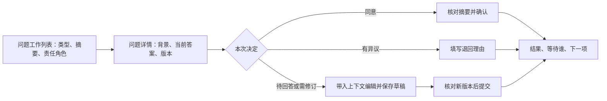

# SpecForge 产品流程体验评审

2026-11-19 · UX-1 · Codex（GPT-6）

**问题的确认、驳回、回答、修订和评论都能完成。产品人员独立处理问题时，需要逐条打开待办才能理解决策内容，从历史中拼出当前答案，还可能在查阅资料时丢失草稿。以独立完成并连续处理下一题为标准，这次体验未通过。**

既有功能开发完成和自动化验收通过，不能代表这一体验目标已经达成。本次建议先改善问题处理主链路，再扩展功能。

## 体验方法与边界

- 对仓库提交 `11bca22` 对应的本地 Web 控制台做专家体验。通过真实 Chrome 点击页面、输入表单和跳转，核对渲染结果与业务历史。
- 从演示项目复制出隔离副本，在 `http://127.0.0.1:4318/` 体验。项目位于 `/private/tmp/specforge-ux-0abEvb/project`。体验完成后已关闭独立服务和浏览器，原 `4317` 演示服务健康检查通过。
- 先查看演示登录与看板，主要流程切换为仅拥有 product 角色的 `pm` 账号，避免用管理员双角色掩盖产品人员的实际限制。截图中的账号、问题与正文均为合成演示内容。
- 建立 M 档变更“产品体验：批量导入异常处理”，准备待确认、待回答、被驳回、等待另一角色等状态。缺失分解树和分析维度是样例设置，不据此判定引擎故障。
- 本次覆盖桌面端登录、看板、审批收件箱、问题确认／驳回／回答／修订、未提交草稿、门禁拦截和产物评论。未做移动端、读屏、真实多人研究、性能基准，也未完成规格审批、最终签字或整条 AI 研发流水线体验。
- 使用本地样例和默认索引。真实模型、飞书发送和外部 PostgreSQL 服务都在本轮范围之外。T2.3c 与 T4.5e 继续暂缓。
- 优先级是本次专家判断：P1 表示影响核心任务完成、决策理解或输入保留，应先修；P2 表示增加学习与操作成本，随后修。没有生产事故或用户统计证据，不给虚假的成功率、耗时和量化评分。

## 实际走过的任务

| 任务 | 实际结果 | 体验判断 |
|---|---|---|
| 登录并寻找待办 | 可进入看板，再进入审批收件箱 | 登录依赖管理员生成令牌；看板未给出当前用户该先做什么 |
| 在收件箱识别两条确认事项 | 两张卡片显示同一变更标题，分别为 Q-1 和 Q-3 第 1 版 | 无问题正文或答案摘要，必须逐条进入才知道要决定什么 |
| 确认重复邮箱处理方式 Q-1 | 进入问题、展开“以 product 身份确认”、提交；历史记录更新，待确认项由 2 变 1 | 操作成功，但当前答案藏在选项标记和核对历史中，缺明确完成反馈和下一题入口 |
| 驳回结果展示方式 Q-3 | 填理由提交成功，原答案不再作为有效结论；收件箱变为 0 项 | 此时仍有 Q-2、Q-3、Q-4 待回答，审批空态没有带用户继续处理这些工作 |
| 回答数据保留期限 Q-2 | 选择 A 后正文仍空；提交被必填校验挡住；补填正文后成功 | 选择题仍要求重复写答案；完成后显示等待 dev 确认 |
| 为 Q-3 编写新版本 | 打开修订表单，选项与正文都没有带入旧版 | 需要来回读取历史和驳回意见，重建编辑上下文 |
| 中途离开再回到 Q-3 | 选 B、输入正文，跳到看板，再返回并打开表单 | 没有离开提醒，选项和正文均丢失；输入丢失已复现 |
| 最终提交 Q-3 新版 | 重新填写 B 与正文，提交生成 v2，保留旧版及驳回记录，显示等待 dev | 版本与历史机制可用，编辑及协作交接体验仍弱 |
| 尝试推进问题样例到规格 | 确认原生对话框后，停留需求分析，提示“门禁未通过：G1” | 拦截正确；缺少按责任角色组织的下一步处理指引 |
| 给 CSV 导入 proposal 第 7 行提意见 | 点击行号，再展开评论表单，提交生成 C-1 待处理 | 后续指引是运行 `sf agent spec csv-import`，页面没有说明由谁接手或在哪里追踪修订 |

审批收件箱按设计只收录已就绪的审批。最初的演示数据没有这类审批，后续驳回又清掉了最后一条待确认事项。两次空列表都符合查询规则，但第二次仍有三条问题待回答，用户要另找入口才能继续工作。

体验结束时，副本 `sf log verify` 返回哈希链完整，共 39 条事件，所有 change 状态、用户名册与日志一致。业务写入走现有 CLI／HTTP／Store，没有直接修改状态文件。

## 需要优先处理的体验问题

| 编号 | 优先级 | 实际观察与影响 | 建议与可验证标准 |
|---|---|---|---|
| UX-01 | P1 | Q-3 修订输入在跳转看板后静默丢失。复杂业务决定可能需要离开查资料，这会造成重复劳动或放弃处理 | 按项目、用户、问题及答案基准版本保存草稿，明确“草稿已保存”；未保存时提示离开。返回恢复选项与正文；版本变化时保留草稿并提示重新核对，不能直接覆盖新答案 |
| UX-02 | P1 | 收件箱只显示变更标题、Q 编号和版本；驳回后显示 0 项，但待回答工作仍在详情。用户难以判断还有什么需要处理 | 建立问题工作列表，区分“待我确认、待回答、已退回待处理、等待其他角色”；列表展示问题摘要、答案摘要、严重程度和下一责任角色。未指派的问题明确标为当前角色可处理，不能冒称个人任务；审批列表为空时仍能发现待回答工作 |
| UX-03 | P1 | 当前结论缺少独立摘要，确认、修订、代录、驳回、推迟、作废挤在一层；确认表单只有说明与“提交” | 详情首先展示问题、业务影响、当前答案全文、版本和确认进度。按状态突出一个主动作，保留清楚的退回入口，把代录、推迟、作废放入次级操作；确认区直接展示即将确认的完整答案和版本，提交按钮写明动作 |
| UX-04 | P1 | “提交新版本答案”选项和正文为空，驳回理由仍在历史里；被驳回卡片还显示“当前版本还缺 product”，容易误认为只需补一次确认 | 修订默认带入旧答案，展示退回原因及新旧差异；被退回状态明确写“需修改答案”，待确认状态再显示缺少的角色。提交后说明旧版确认已失效、等待哪些角色重新核对 |
| UX-05 | P1 | 确认、驳回和回答完成后主要靠标签、排序和历史变化表达结果。Q-1 确认后移到问题末尾，没有“下一项”；用户需返回收件箱再进入 | 显示持久可见的结果摘要，如“已确认 v1，仍有 1 项待确认”或“已提交 v2，等待开发确认”；提供下一项及返回列表，并保存筛选与位置。结果反馈应可被辅助技术感知；不自动确认下一题 |
| UX-06 | P1 | 当前 G1 不满足时，“推进到规格”仍可点击，确认后只提示 G1 未通过。下方同时展示未来 G2～G4 的大量失败项，当前阻碍和未来准备混在一起 | 优先展示本阶段推进条件，按“我可处理／等待其他角色／需补充材料”分组，提供问题直达链接。未来阶段标为待准备并可展开；不能把尚未开始的材料缺失表现成眼前故障。服务端仍须在每次推进时重新校验 |
| UX-07 | P2 | Q-2 选中已有完整选项后，正文必填仍拦截提交；用户需重复录入同一意思 | 将选项作为明确的答案基础，补充说明按业务需要填写；选项的影响与推荐理由一起展示。引擎仍接收完整、明确的答案；补充内容不因切换选项意外丢失 |
| UX-08 | P2 | 看板以七个阶段列为主，卡片无待办摘要或下一责任角色；首屏暴露 change ID、M 档、链头状态等工程信息 | 产品视角优先展示待处理事项与数量，卡片显示“需要你确认 2 个问题／等待开发”等事实；阶段总览和审计信息保留可访问入口。列表清晰可扫读，不只填充留白 |
| UX-09 | P2 | proposal 以 Markdown 源码和行号呈现，评论需先点行号再点“评论第 n 行”；提交后给出 CLI 运行要求，没有页面内交接去向 | 默认提供可读文档与评论侧栏，保留源码模式；提交后说明意见已记录、后续由何种角色处理、如何追踪。先补交接入口和状态，不擅自启动收费模型；没有指派能力时如实标为待开发处理 |
| UX-10 | P2 | 登录页解释管理员通过 CLI 生成一次性令牌，非技术产品人员需要额外理解令牌概念 | 用面向成员的语言说明账号、登录凭证和重置途径，提供清楚的管理员联系入口；将 CLI 命令放入管理说明。是否更换认证方式需另定范围，本次不建议仅为演示改掉权限机制 |

## 为什么这些问题会让用户觉得“处理问题不友好”

核心任务是对一个业务分歧作出决定。用户首先需要看懂问题及影响，比较当前答案，选择同意或退回，最后确认本次工作完成并知道后续责任。当前界面围绕数据对象和可调用动作组织：变更、阶段、门禁、问题版本、角色、全部写操作都展示出来，却把上述决策上下文留给用户拼接。

例如 Q-3 被退回后，用户要自己从空收件箱返回变更，在长页面中找到问题，从历史里读出旧答案和退回理由，再从空白表单重写。若去看板核对别的信息，草稿又会丢失。这几个单点叠加后，即使每个接口都返回成功，整项工作仍很费力。

## 推荐的目标流程

问题详情建议采用稳定的阅读顺序：**问题与业务影响 → 当前答案和版本 → 已确认／待确认角色 → 本次操作 → 核对历史**。审计、关联任务和技术证据按需展开。默认信息应帮助完成当前决定，仍然保留引擎规则与证据追溯。

动作名称应指向结果，例如“确认此答案”“退回修改”“提交修订”，避免多个表单都使用泛化的“提交”。对退回问题明确显示退回理由；对已提交的新版本明确显示等待谁；对门禁受阻明确显示应处理哪些事项。

## 建议实施顺序及完成标准

| 建议阶段 | 覆盖问题 | 交付与验收重点 |
|---|---|---|
| 第一轮：问题处理主链路 | UX-01～05、UX-07 | 先给待确认、待回答、被退回、等待他人四种状态画具体页面与状态流，再实施列表、答案摘要、表单、草稿和结果反馈。用本次四个问题从产品角色连续处理，检查无需 CLI 或外部讲解就能找到下一项；离开返回草稿恢复；修订必须重新核对版本 |
| 第二轮：推进与协作交接 | UX-06、UX-09 | 当前门禁提供可处理清单、责任角色和跳转；评论有交接去向和状态。不得放宽门禁、取消历史或暗中触发收费模型 |
| 第三轮：入口与表达 | UX-08、UX-10 | 调整看板首屏、业务术语与登录说明；邀请真实产品人员完成相同任务，记录卡点，再决定是否拓展认证和管理能力 |

第一轮的完成标准是用户能从待办开始，连续完成业务决策，并知道结果和去向。验收时同时检查角色权限、旧答案冲突保护和历史保留。邀请产品人员复测时，记录实际完成情况与求助点。

## 值得保留的机制

- 本人确认来自已登录身份，权限区分可见；产品账号的开发审批按钮被禁用。
- 实测确认、驳回和新版答案都进入核对历史，旧版和退回理由仍可追溯；待审批列表随处理结果更新。
- 被驳回答案不会继续作为有效结论，未满足 G1 的推进被引擎阻止。
- 写入请求运行时，页面会显示“提交中…”。
- 旧答案的并发冲突保护已有历史功能验收，本次没有重新执行，报告不将其列为新增通过或新增故障。

## 截图证据

截图按操作顺序采集，事件数与问题状态随之变化。看板截图使用初始演示账号，问题处理截图使用产品账号。问题详情长图保留了截取时的滚动位置。

| 证据 | 对应观察 |
|---|---|
| [01 看板](assets/ux-review-2026-11-19/01-board.png) | 阶段总览优先，缺少具体待办引导 |
| [02 两项待确认](assets/ux-review-2026-11-19/02-inbox.png) | 卡片只有变更标题、Q 编号和版本 |
| [03 问题详情](assets/ux-review-2026-11-19/03-questions.png) | 多种动作并列、当前答案依赖标记与历史 |
| [04 驳回后审批为空](assets/ux-review-2026-11-19/04-empty-inbox.png) | 待回答工作未被工作入口承接 |
| [05 已选选项但答案仍空](assets/ux-review-2026-11-19/05-option-answer.png) | 完整选项与必填正文之间重复录入 |
| [06 离开前的草稿](assets/ux-review-2026-11-19/06-draft-before.png) | 选 B，已输入修订正文 |
| [07 返回后草稿丢失](assets/ux-review-2026-11-19/07-draft-after.png) | 选项回到不选，正文为空 |
| [08 推进被正确拦截](assets/ux-review-2026-11-19/08-gate-blocked.png) | G1 简短报错与多个阶段失败信息混排 |
| [09 评论已记录及 CLI 指引](assets/ux-review-2026-11-19/09-comment.png) | 意见可写入，后续交接仍依赖技术操作 |

## 实现定位与验证记录

下列源码对应浏览器中观察到的行为。

- [Inbox.tsx](../apps/web/src/views/Inbox.tsx)：审批事项卡片和空态。
- [AnalysisView.tsx](../apps/web/src/views/AnalysisView.tsx)：问题展示、核对历史、状态与动作组合。
- [Action.tsx](../apps/web/src/views/Action.tsx)：字段初始值、表单状态和完成后的刷新。
- [ChangeView.tsx](../apps/web/src/views/ChangeView.tsx)：阶段、全部门禁及推进按钮。
- [ArtifactsView.tsx](../apps/web/src/views/ArtifactsView.tsx)：源码行评论及命令指引。
- [Board.tsx](../apps/web/src/views/Board.tsx)、[Login.tsx](../apps/web/src/views/Login.tsx)：入口展示与登录说明。

本轮变更为报告、截图和任务记录。功能测试（406/406）及类型检查采用当天已有基线。体验结论来自上述实际操作。推进对话框曾阻塞浏览器控制脚本，换用处理对话框的新标签页后完成观察。

下一建议任务是问题处理主链路交互改造，先形成可评审页面，再按上述标准实施与验收。
